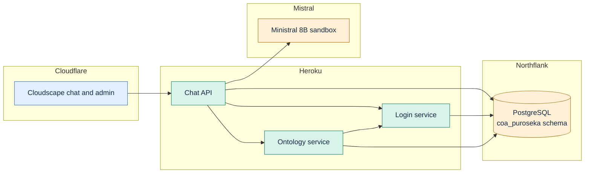

# Puroseka context ontology demo

A small implementation based on [AWS Context Ontology Accelerator (COA) v0.3.7](https://github.com/aws/context-ontology-accelerator/tree/v0.3.7): a fixed ontology helps a language model query historical event rankings and game metadata using PostgreSQL.

## Notice

> [!IMPORTANT]  
>This is an independent demonstration, **not affiliated with or endorsed by Project SEKAI or its rights holders**. Data is obtained from **[sekai.best datasets (Sekai Viewer)](https://sekai.best/)**. Source data and generated artifacts are not distributed in this repository. Credits and licenses: [THIRD_PARTY.md](THIRD_PARTY.md), [upstream NOTICE](NOTICE), [LICENSE](LICENSE).

## Try the demo

Open **[Puroseka chat](https://chat.coa.puroseka.02labs.me/)**.

| Email | Password | Shared allowance |
|---|---|---|
| `demo@02labs.me` | `demo1234` | 100,000 input/output tokens per six-hour window |

Credentials are intentionally public. All visitors share approximately 100,000 tokens across 6 hour windows, including both responses in A/B mode. The reset time is shown in chat.

Choose **Enhanced** for ontology context, **No enhancement** for the physical schema, or **A/B testing** to compare both using `ministral-8b-latest`. Try:

- Compare rank 100 progression in events 1 and 2 by elapsed event day.
- Show the daily score evolution at rank 100 in event 1.
- Which characters have cards associated with event 1?

## Data and context ontology

The imported dataset has **180 events**, 1,229 cards, 26 characters, 950 event-card associations, 815 gachas, and **1,117,619 ranking observations**. Ranking histories cover 142 events; the other 38 have no observations. All available observations are retained across 16 registered tables. There are 2,250 source/generated labels.


The diagram was regenerated from the supplied `puroseka-1.1.0` Turtle ontology: **16 classes, 15 object properties, 185 datatype properties and 850 RDF triples**.

| Element | Content |
|---|---|
| Catalog | Entity classes, table and column definitions, aliases, data types and coverage |
| Relationships | 15 associations connecting cards, characters, events, gachas and rankings |
| Rules | Meaning of timestamps, joins, ranking endpoints, daily changes and missing observations |
| RDF | Classes, datatype properties and object properties in `ontology.ttl` |
| Labels | Original names and approximate English convenience labels |
| NL2SQL examples | Six question/SQL pairs for comparisons, daily evolution, event cards and gacha pools |

Example column meanings:

| Column | Meaning |
|---|---|
| `events.start_at` | Competition start, Unix epoch milliseconds |
| `events.aggregate_at` | Competition aggregation boundary; `closed_at` is a later lifecycle boundary |
| `ranking_observations.observed_at` | PostgreSQL timestamp with time zone, already a timestamp |
| `ranking_observations.score` | Cumulative points observed at a rank; not a daily gain |
| `ranking_observations.row_key` | Source provenance and deterministic tie-breaker; this table has no `id` column |
| `event_cards.card_id` | Explicit card association; does not by itself prove pickup or bonus status |


Definitions are stored in [services/ontology/semantic/](services/ontology/semantic/). The prepared catalog, RDF, labels and examples are imported once into the database.

## Architecture



- `services/chat/`: authenticated browser API, model calls, asynchronous responses, token accounting and demo retention.
- `services/ontology/`: immutable semantic context, source inspection and guarded read-only SQL.
- `services/login/`: Argon2id password hashes with login-time scrypt upgrades, persistent opaque sessions, roles and login throttling.
- `shared/`: configuration, database connection plumbing, service authentication and RPC.
- `web/`: independent React/Cloudscape frontend and its Node dependencies.
- `infra/`, `scripts/`, `tests/`: deployment, operator tooling and verification.

## SQL firewall

Every model-generated query passes through the ontology service's [SQL firewall](services/ontology/firewall.py) before execution. It accepts one SELECT using approved source tables, query constructs, built-in functions and built-in cast types. It rejects writes, schema changes, writable CTEs, SELECT INTO, row locks, stacked statements, private/system tables, schema-qualified functions, custom operators/types and unreviewed syntax. Rejected queries are not retried with weaker rules. Comments are removed and query length, AST size and nesting are bounded.


## Setup and deployment

1. Install Python 3.15, Node 24, the Heroku CLI and Cloudflare CLI (`cf`), then install dependencies:

   ```bash
   python3.15 -m venv .venv
   .venv/bin/pip install -r infra/requirements.txt
   npm --prefix web ci
   ```

2. Create `.env` from [.env.example](.env.example). Set the database connections, admin credentials, Mistral key/model, service tokens and frontend origin. Record the three existing Eco apps and their URLs in `.deploy/heroku-services.json`.

3. Authenticate:

   ```bash
   heroku login
   cf auth login
   ```

4. For a new dataset/schema, configure the source database and artifact paths in `.env`, then run:

   ```bash
   .venv/bin/python scripts/backup_target.py
   .venv/bin/python scripts/migrate_postgres.py
   .venv/bin/python scripts/provision_demo.py
   ```

   For an existing import, update curated examples with `.venv/bin/python scripts/update_query_examples.py`.

5. Provision the three service database credentials:

   ```bash
   .venv/bin/python scripts/provision_service_roles.py
   ```

   To apply credential changes to running apps, run `.venv/bin/python scripts/activate_service_roles.py`.

6. Set `LOCAL_TEST_DATABASE_URL` to a disposable local PostgreSQL database, run checks and build the frontend:

   ```bash
   .venv/bin/python -m pytest -c tests/pyproject.toml -q
   VITE_API_ORIGIN=https://api.coa.puroseka.02labs.me npm --prefix web run build
   ```

7. Commit source changes, audit and push `main`:

   ```bash
   PRIVATE_REFERENCE_ENV=/path/to/private/reference.env .venv/bin/python scripts/audit_publication.py
   git push origin main
   ```

8. Deploy the backend and frontend:

   ```bash
   .venv/bin/python scripts/deploy_heroku.py
   .venv/bin/python scripts/deploy_frontend.py
   ```

9. Open [the chat](https://chat.coa.puroseka.02labs.me/) and [admin dashboard](https://chat.coa.puroseka.02labs.me/admin).
