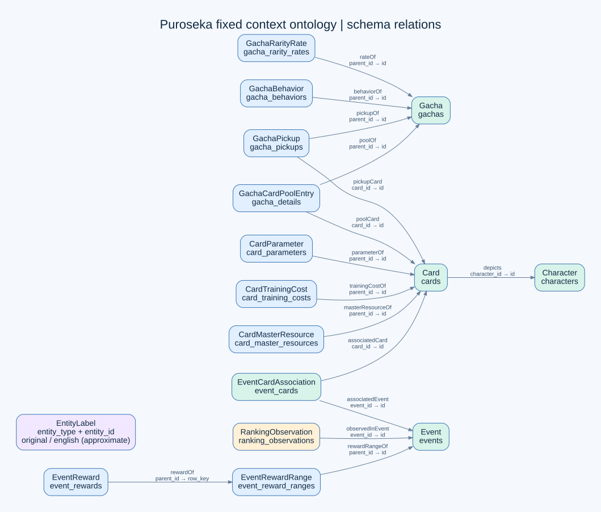
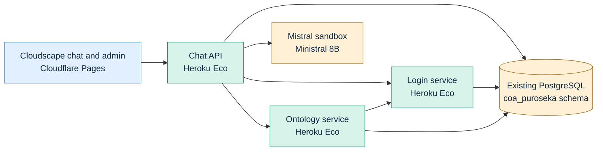

# Puroseka context ontology demo

A small implementation based on [AWS Context Ontology Accelerator (COA) v0.3.7](https://github.com/aws/context-ontology-accelerator/tree/v0.3.7): a fixed ontology helps a language model query historical event rankings and game metadata using PostgreSQL.

This is an independent demonstration, **not affiliated with or endorsed by Project SEKAI or its rights holders**. Data is obtained from **[sekai.best datasets (Sekai Viewer)](https://sekai.best/)**. Source data, generated artifacts, and private credentials are not distributed in this repository. Credits and licenses: [THIRD_PARTY.md](THIRD_PARTY.md), [upstream NOTICE](NOTICE), [LICENSE](LICENSE).

## Try the demo

Open **[Puroseka chat](https://chat.coa.puroseka.02labs.me/)**.

| Email | Password | Shared allowance |
|---|---|---|
| `demo@02labs.me` | `demo1234` | 25,000 input/output tokens per six-hour window |

These credentials are intentionally public. All visitors share the allowance: approximately 100,000 tokens across four windows, including both responses in A/B mode. The reset time is shown in chat. The Mistral sandbox has its own limits; Eco services may take time to wake up.

Choose **Enhanced** for ontology context, **No enhancement** for the physical schema, or **A/B testing** to compare both using `ministral-8b-latest`. Try:

- Compare rank 100 progression in events 1 and 2 by elapsed event day.
- Show the daily score evolution at rank 100 in event 1.
- Which characters have cards associated with event 1?

Demo jobs do not store the submitted question, conversation history, or full Review traces. Responses and activity metadata expire after 24 hours. Cleanup runs on startup and every ten minutes while the existing chat process is awake; expired responses cannot be retrieved even before cleanup. Responses can repeat parts of a question. Browser conversation history stays on that browser until deleted using **Delete chat**. Token counters are retained independently and cleanup never replenishes the allowance.

The full-snapshot daily-gap example uses a covering UTC-day index, preserving all source observations while avoiding scans of the raw JSON pages.

The private administrator can open the [dashboard](https://chat.coa.puroseka.02labs.me/admin/sources), inspect sources and ontology relations, and use Review mode for tool input/output JSON and executed SQL. Public demo access is chat only.

In **Manage → Token limits**, select **Public demo** to configure its enforcement, token allowance and window duration, or **Administrator** to manage the admin account separately. The initial demo policy is 25,000 tokens per six-hour window; the live policy and usage are shown in the dashboard. Saving preserves used tokens and active reservations. Allowance and enforcement changes apply immediately; a changed window duration applies after the current window resets. Reprovisioning the demo preserves customized policies.

## Data and context ontology

The imported snapshot has **180 events**, 1,229 cards, 26 characters, 950 event-card associations, 815 gachas, and **1,117,619 ranking observations**. Ranking histories cover 142 events; the other 38 have no observations. All available observations are retained across 16 registered tables. There are 2,250 source/generated labels.



Arrows connect a referencing table to its referenced entity. Labels are a separate lookup by entity type and ID, rather than an asserted foreign key. The editable diagram source is [ontology-relations.dot](docs/ontology-relations.dot).

The fixed `puroseka-1.1.0` release contains:

| Element | Content |
|---|---|
| Catalog | Entity classes, table and column definitions, aliases, data types and coverage |
| Relationships | 15 validated associations connecting cards, characters, events, gachas and rankings |
| Rules | Meaning of timestamps, joins, ranking endpoints, daily changes and missing observations |
| RDF | Classes, datatype properties and object properties in `ontology.ttl` |
| Labels | Original names and approximate English convenience labels |
| NL2SQL examples | Six curated question/SQL pairs for comparisons, daily evolution, event cards and gacha pools |

Example column meanings:

| Column | Meaning |
|---|---|
| `events.start_at` | Competition start, Unix epoch milliseconds |
| `events.aggregate_at` | Competition aggregation boundary; `closed_at` is a later lifecycle boundary |
| `ranking_observations.observed_at` | PostgreSQL timestamp with time zone, already a timestamp |
| `ranking_observations.score` | Cumulative points observed at a rank; not a daily gain |
| `ranking_observations.row_key` | Source provenance and deterministic tie-breaker; this table has no `id` column |
| `event_cards.card_id` | Explicit card association; does not by itself prove pickup or bonus status |

For daily evolution, use the latest observation per event/rank/UTC day. Differences between endpoints include the elapsed-day gap: missing days are not zero. Compare event progression at the same rank by elapsed 24-hour event days. A last observed score is historical evidence, not a guaranteed official final cutoff. Pool membership does not establish drop probability.

Curated definitions live in [services/ontology/semantic/](services/ontology/semantic/). The prepared catalog, RDF, labels and examples are imported once into the database. There is no runtime enrichment agent.

## Architecture



- `services/chat/`: authenticated browser API, model calls, asynchronous responses, token accounting and demo retention.
- `services/ontology/`: immutable semantic context, source inspection and guarded read-only SQL.
- `services/login/`: scrypt password hashes, persistent opaque sessions, roles and login throttling.
- `shared/`: configuration, database connection plumbing, service authentication and RPC.
- `web/`: independent React/Cloudscape frontend and its Node dependencies.
- `infra/`, `scripts/`, `tests/`: deployment, operator tooling and verification.

Enhanced requests add definitions, relationships, rules, coverage, relevant labels and six examples to the physical schema. SQL runs through an AST allowlist, read-only transactions, timeouts and output bounds. Syntax/schema errors receive at most one metered correction attempt; rejected unsafe queries and service outages are never retried by the model. Ranking answers format returned evidence deterministically.

## Setup and deployment

Use Python 3.15 and Node 24. Private configuration goes in an ignored `.env`:

```bash
python3 -m venv .venv
.venv/bin/pip install -r infra/requirements.txt
cp .env.example .env
npm --prefix web ci
.venv/bin/python -m pytest -c tests/pyproject.toml -q
VITE_API_ORIGIN=https://api.coa.puroseka.02labs.me npm --prefix web run build
```

Each backend owns `services/<name>/requirements.txt` and `.python-version`; common dependencies are in `shared/requirements.txt`. To install just one backend, use its requirements file. Local startup uses `COA_SERVICE=chat`, `login`, or `ontology` and `python infra/heroku/start.py`. Set its database URL, service URLs/tokens and port as described in [.env.example](.env.example).

For a new private dataset import, configure the existing target database, a restored source database, and prepared artifacts using the migration variables in `.env`. Take and restore-check a backup, then import into the new schema:

```bash
.venv/bin/python scripts/backup_target.py
.venv/bin/python scripts/migrate_postgres.py
.venv/bin/python scripts/provision_demo.py
# For an existing import: validate and publish the current curated examples.
.venv/bin/python scripts/update_query_examples.py
```

The importer refuses an existing destination schema and verifies counts, fingerprints and SQL example parity. The operator database credential stays local. Reprovisioning the demo preserves consumed tokens. Use a disposable local PostgreSQL database for database tests via `LOCAL_TEST_DATABASE_URL`.

Deployment uses the three existing recorded **Eco web apps only**, without add-ons, workers or schedulers. Authenticate the Heroku CLI and `cf auth login`; local app IDs and URLs are recorded in ignored `.deploy/heroku-services.json`. Publish an audited commit to this repository, then run:

```bash
PRIVATE_REFERENCE_ENV=/path/to/private/reference.env .venv/bin/python scripts/audit_publication.py
.venv/bin/python scripts/deploy_heroku.py
.venv/bin/python scripts/deploy_frontend.py
```

Backend deployment packages tracked code for each service, adding root build files only inside its temporary Heroku source archive. It verifies one Eco web process and zero add-ons before rebuilding the recorded apps. No database or other resource is provisioned. Frontend deployment uploads only checked static assets. The API is `https://api.coa.puroseka.02labs.me`; frontend CORS accepts the exact chat origin and mutations require CSRF protection.

Both custom DNS records are DNS-only. Cloudflare Pages manages the frontend certificate; Heroku ACM manages the API certificate. The frontend helper uses the authenticated `cf` session, with the Pages API for asset uploads unsupported by the installed CLI. Deployment receipts remain private.
