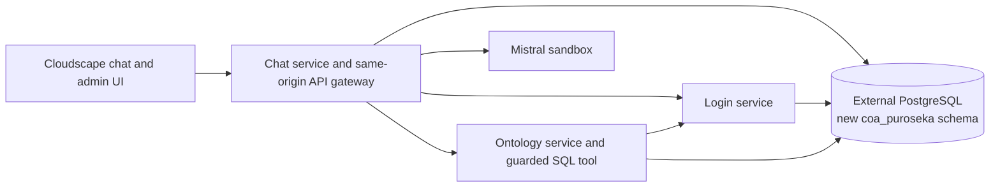

# Heroku migration plan: ontology, chat, and login services

Status: migration and authenticated production acceptance completed. All 16 source tables, the prepared ontology, and application state were imported into the existing external database under `coa_puroseka`. All source fingerprints and five curated query results matched. Login, ontology access, Base/Enhanced inference, comparisons, daily evolution, reviews, and session/meter persistence after Eco restarts passed. Only three Eco web dynos are deployed; there are no add-ons or other dyno types. AWS remains unchanged.

Repository decision: the existing `coa-puroseka` GitHub repository is unchanged. Audited source has been published separately at [coa-puroseka-heroku](https://github.com/02loveslollipop/coa-puroseka-heroku). Publish only reviewed source, infrastructure definitions, and documentation; exclude credentials, datasets, dumps, generated ontology/data artifacts, and operational reports. The separate local working directory is `/home/zerotwo/coa-puroseka-heroku`, initialized with fresh Git history and a remote pointing only to the new repository. Keep its remote separate so publishing it cannot push to the AWS repository by mistake. Both chat and admin repository header links point to the new repository.

## 1. Verified starting point

Inspection date: 24 October 2026 UTC.

| Item | Verified state |
|---|---|
| Source | AWS RDS PostgreSQL 16.15; the live application remains available |
| Application database | `puroseka`, with 16 `data` tables and six `control` tables |
| Source coverage | 180 events; 1,117,619 ranking observations; 2,250 labels |
| Fixed semantic release | `puroseka-1.1.0`; five curated NL2SQL examples |
| Model | `ministral-8b-latest`; continue using the existing Mistral sandbox |
| Token policy | Enforcement off; preserve usage and configuration |
| Application hosting | Heroku, with separate ontology, chat, and login applications |
| Current database target | User-supplied external PostgreSQL endpoint; connection string saved only in ignored local configuration |
| Target connectivity | Corrected public connection works; all three Eco apps have updated database configuration |
| Target database | PostgreSQL 18.4; imported application database approximately 1.64 GB; existing unrelated objects preserved |
| Operator/runtime access | Operator owns the new schema; the existing runtime account has USAGE and scoped table grants, with no schema CREATE or source-data writes |
| Application namespace | `coa_puroseka`; imported and verified |

AWS credentials were refreshed in the local default profile and verified against the existing lab account. Credentials are outside the Git repository. Heroku CLI authentication is now working. The replacement connection string is stored in `.env` as `MIGRATION_DATABASE_URL` and in private deployment state, with owner-only file permissions. Never copy its value into this document or Git.

The previous Heroku add-on, `postgresql-regular-72196` on `db-app`, was inspected and backed up before the target changed. It is no longer the migration destination. Do not upgrade it or attach it to the new services for this migration.

## 2. Backups and restore evidence

The private AWS backup set remains under `/home/zerotwo/coa_puroseka/.deploy/backups/20261024T004403Z/` in the original checkout. A second copy is prepared on `/mnt/nfs/ZeroTwoShare-1/coa_database_backups_20261024T004403Z/`.

- `database-00.dump`: AWS maintenance database `postgres`, with no application tables.
- `database-01.dump`: complete AWS application database, including source records, ontology labels, accounts, token accounting, jobs, review payloads, sessions, and login-attempt state.
- `manifest.json`: checksums, source sizes, and table counts collected from the same exported PostgreSQL snapshot used by each dump.
- `restore-verification.json`: successful isolated PostgreSQL 16 restores, all 22 table counts matching, and all five curated SQL examples executing.
- `heroku-before-migration.dump`: backup of the previously selected Heroku database, retained as historical evidence; it does not back up the replacement external target.
- `heroku-restore-verification.json`: isolated PostgreSQL 18 restore check for that previous target.
- `SHA256SUMS`: checksums for the private backup files.

AWS dumps also have an encrypted copy in the existing private S3 artifact bucket. Temporary backup compute is separate from the production ECS service. The restore tests use disposable local containers without networking. Source and destination backups are private operational artifacts and must not be committed or pushed.

**Replacement-target backup is verified.** A fresh custom-format PostgreSQL 18 dump was captured read-only and fully restored in an isolated local container. The existing target has no application tables; its schema/function definitions and monitoring extensions restored successfully. A matching local restore image installs `pg_stat_kcache` and preloads it with `pg_stat_statements`, following the extension maintainer's [installation instructions](https://github.com/powa-team/pg_stat_kcache#installation). This image is local tooling only and is never deployed to Heroku. Checksums and a second private copy are retained on the share; paths and manifests remain ignored. The earlier Heroku backup is separate historical evidence.

These are online snapshots, not the final cutover snapshot. Source data is fixed, but users can still create sessions, jobs, and token-ledger records. Drain jobs and take a final consistent control-state backup immediately before switching traffic.

## 3. Capacity and access checks before migration

The source database occupies approximately 1.66 GB. A clean restore occupies **1,601,215,511 bytes**, approximately 1.60 GB or 1.49 GiB. The compressed application dump is approximately 83.5 MB; this compressed file size is not the space PostgreSQL needs after restoration.

The replacement database needs room for the full restored dataset **in addition to** its existing workloads, indexes, temporary work, jobs, review data growth, and maintenance headroom. Its storage allowance and connection quota are not established by its connection string and have not been verified. Check these with the provider before importing; `pg_database_size` measures usage, not the storage entitlement.

The old Heroku Essential-0 add-on's 1 GB allowance was insufficient for the complete dataset, which prompted the replacement-target decision. That old limit does not describe the new target. No Heroku database upgrade is part of this plan. Do not silently sample events/ranks, remove observations, truncate source JSON, or discard review/accounting history to fit an unverified allowance.

Inspect schema-creation rights, object ownership, role-creation permissions, and the provider's support for separate runtime credentials. Prefer a read-only ontology/query role and separate login/chat roles restricted to their owned tables, with an operator credential used only for provisioning. The supplied administrator connection was used locally for provisioning and import; it was not sent to Heroku. No new runtime roles were needed: the existing runtime account received schema USAGE, source/ontology SELECT, auth-account SELECT, and the application-table access needed for sessions, jobs, throttling, and metering. Source writes and schema CREATE are denied to that account. Never grant runtime services access to unrelated schemas. If the provider only permits one owner credential, document that shared ownership supplies logical separation through service/table allowlists rather than a database privilege boundary; do not claim separate-role isolation.

## 4. Three independently deployable services

Use three Heroku applications from the new `coa-puroseka-heroku` repository, each with its own entrypoint and configuration. Names below are logical names; actual app-name availability will be checked during deployment. PostgreSQL remains hosted at the supplied external provider; `db-app` is not part of the new application topology.

| Service | Responsibilities | Owned objects inside `coa_puroseka` |
|---|---|---|
| Ontology | Fixed versioned catalog, definitions, relationships, rules, few-shots, label lookup, schema/data inspection, RDF export, guarded read-only SQL tool | The 16 source tables; `ontology_versions`; `ontology_examples` |
| Chat | Browser UI and COA admin UI delivery, same-origin API routing, inference orchestration, A/B comparison, jobs, review traces, metering and token policy | `chat_jobs`, `chat_budgets`, `chat_reservations`, `chat_policies` |
| Login | Local password verification, account roles, opaque session issuance/introspection/revocation, persistent login throttling | `auth_accounts`, `auth_sessions`, `auth_login_attempts` |

The ontology remains a one-time prepared release. This service makes it independently accessible and deployable; it does not add an enrichment agent, automatic ontology generation, or model-driven ontology writes. New releases, if later requested, are explicit operator imports.



Only the chat service receives the Mistral API key. None of the Heroku services needs Cognito configuration or AWS credentials at runtime. Keep generated artifacts out of images and source archives: persist the catalog, RDF, manifests, and examples in the target schema, while normalized source data lives in its tables.

### Code layout

```text
services/
  ontology/     # FastAPI entrypoint, catalog/version store, data tool
  chat/         # FastAPI entrypoint, browser gateway, inference and jobs
  login/        # FastAPI entrypoint, accounts and sessions
shared/         # Typed API contracts, config validation, low-level DB helpers
web/            # Existing Cloudscape UI
infra/heroku/   # Service-specific container/build and release configuration
scripts/        # Scoped schema migration, data copy, verification and rollback
```

Retain the existing AWS entrypoint in the original checkout until cutover is validated. The new repository contains no AWS deployment templates or provisioning commands. Service entrypoints must not import another service's application logic to bypass its API.

## 5. Authentication without Cognito

Keep one email/password account shared between chat and administration. Reuse the existing salted scrypt password hashing, constant-time comparison, role checks, durable login throttling, one-hour sessions, and explicit logout behavior in the dedicated login service.

Cognito passwords cannot be exported. Seed the password hash through a one-time command using the credentials already held in the private local `.env`; never place plaintext passwords in migration SQL, frontend bundles, logs, or committed configuration. Preserve the administrator identity and role. Do not copy old AWS-origin browser sessions as usable Heroku sessions; require a fresh sign-in.

The browser talks only to the chat application's origin, including `/admin`. The chat service proxies login operations to the login service over HTTPS and sets its own host-scoped Secure, HttpOnly, SameSite=Strict cookie. Preserve Origin and CSRF checks. Do not attempt to share cookies across unrelated `herokuapp.com` application domains.

Protect inter-service APIs with separate service credentials in Heroku config vars. Login session introspection validates the supplied opaque session; callers cannot assert a username or administrator role through an unverified header. The ontology service validates both the service caller and the end-user authorization. Never include service credentials, session tokens, cookies, or password inputs in Review mode traces.

## 6. Preserve the UI/API behavior

Retain existing browser-facing routes through the chat service so the React application needs minimal changes:

| Browser routes | Destination |
|---|---|
| `/api/auth/login`, `/api/auth/me`, `/api/auth/logout` | Login service via same-origin chat proxy |
| `/api/catalog`, `/api/schema`, `/api/tables/*`, `/api/rankings`, `/api/ontology.ttl`, manifests and translations | Ontology service, administrator authorization retained |
| `/api/chat/jobs`, `/api/inference/jobs`, `/api/jobs/*`, `/api/usage`, token-policy administration | Chat service |
| `/`, `/admin/*`, `/assets/*` | Existing frontend served by chat service |

Keep No enhancement, Enhanced, A/B comparison, sidebar controls, review JSON, tool activity before the answer, SQL/results inside the answer, and chat deletion. Change both GitHub header links to the new repository at release. Base mode receives only the registered source-table schema; Enhanced mode adds the fixed semantic context and five examples. Both use the same 8B model. The deployed UI retains the fixed model instead of adding a paid-model fallback.

Retain HTTP 202 job submission and polling instead of keeping a request open for Mistral completion. Persist jobs and usage in PostgreSQL. Keep the small PoC's in-service runner initially, with persisted progress and interrupted-job detection; do not automatically replay model calls after a dyno restart. A separate worker dyno is a later reliability/scaling option and is not included in the three-web-dyno baseline.

Reference: [Heroku request timeouts and background-work guidance](https://devcenter.heroku.com/articles/request-timeout).

## 7. Schema-safe data migration

Create only the new `coa_puroseka` schema after checking that it is still unused. If that name already exists, stop and select a fresh namespace rather than adopting or overwriting its objects. Do not rename the shared database, reset `public`, alter provider-managed schemas, drop another application's objects, or run a full restore with `--clean` against the shared target.

Map the source objects as follows:

| Source | Target |
|---|---|
| `data.<source_table>` | `coa_puroseka.<source_table>` for all 16 source tables |
| `control.accounts` | `auth_accounts`, with identity fields retained; policy fields moved to `chat_policies` |
| `control.budgets` | `chat_budgets` |
| `control.reservations` | `chat_reservations` |
| `control.jobs` | `chat_jobs`, preserving request/result JSON and private review records |
| `control.sessions` | Archive in the backup; issue new Heroku-origin sessions |
| `control.login_attempts` | Retain backup history; initialize the new origin's throttling state explicitly |
| Prepared catalog/RDF/manifests and examples | `ontology_versions` and `ontology_examples` |

Use a versioned migration ledger inside the new schema. Derive DDL from the source schema, quote identifiers, and stream all values with PostgreSQL COPY. Remap table references, foreign keys, indexes, defaults, and SQL-example identifiers explicitly. Do not globally replace strings inside a SQL dump or JSON source records.

The original AWS importer calls `DROP SCHEMA data CASCADE`; it is excluded from the new repository. `scripts/migrate_postgres.py` copies into an unused schema transactionally, preserving source JSON without global replacement. The runtime schema is configured for introspection, SQL validation/generation, previews, ranking queries, and remapped SQL examples.

**Critical shared-schema constraint:** introspection and generated SQL may expose only the 16 registered source tables. Authentication, policies, sessions, jobs, reservations, and ontology-version storage must never enter the physical schema supplied to the model or its table allowlist. A schema filter alone is insufficient because these objects will share the same schema.

Keep SELECT-only AST validation, explicit schema qualification, read-only transactions, statement/lock timeouts, and bounded rows/bytes. These protect the query path; a restricted database role, when supported, provides an additional independent boundary.

Before accepting migration success, compare every source-table count, all validated relationships, important null/duplicate coverage, and canonical content fingerprints from the restored source snapshot. Test the five curated queries against both copies and compare ordered results. Preserve original JSON, provenance keys, labels, timestamps, indexes, and all observations.

## 8. Heroku runtime configuration

- Configure each Heroku service with the external database URL, using separate restricted credentials when supported. This is an external connection, not a Heroku database add-on attachment. Do not provision or upgrade a Heroku database for this migration.
- `app.json` permits one Eco web dyno per service, no add-ons, and no release/postdeploy commands. `scripts/deploy_heroku.py` validates this before using app-setups; no worker or one-off dyno is created. Never fall back to another size.
- Bind each web process to `0.0.0.0:$PORT`. The current hardcoded port 8000 must be adapted.
- Use Heroku config vars for credentials and service URLs; remove `APP_SECRET_ARN`, `ADMIN_SECRET_ARN`, Cognito configuration, and AWS dependency from the new runtime path.
- Keep state in PostgreSQL; dyno filesystems are ephemeral. Do not generate persistent ontology files or store job results on local dyno disk.
- Verify the provider's connection quota and any role-level cap. The server's `SHOW max_connections` is not proof of an application's allowed quota. Use bounded connection concurrency of 2 for login, 2 for ontology, and 4 for chat only if the verified quota leaves maintenance and existing-workload headroom. Do not let worker/thread counts multiply those limits unexpectedly.
- Use TLS for database and service connections, short connection timeouts, health/readiness endpoints, and per-service log tags.
- Maintain token enforcement off and preserve metering. Shared account usage must not reset on service restart or migration.

Reference: [Heroku container runtime](https://devcenter.heroku.com/articles/container-registry-and-runtime).

## 9. Delivery sequence and acceptance gates

1. Restore external-target connectivity and inspect its version, privileges, namespace availability, storage allowance, and connection quota. Confirm `coa_puroseka` is unused. Do not change paid plans during planning.
2. Complete and verify the replacement-target backup; retain the verified AWS backups and private share copies. Keep sensitive dumps and reports out of source control.
3. Create a separate local working directory and Git history for `coa-puroseka-heroku`; refactor into three entrypoints with shared typed contracts. Keep the AWS repository and deployment unchanged.
4. Build and test the three-service topology locally against a scratch database matching the verified replacement target's PostgreSQL major version, including schema remapping and a sentinel unrelated schema that migrations cannot alter.
5. Implement the scoped schema/data migration, local password seeding, explicit session invalidation, and durable policy/job migration. Test forbidden table/schema access and cross-user review isolation.
6. Provision only the verified new namespace and, if supported, scoped service roles. Recheck storage and connection headroom immediately before import.
7. Apply only the new schema migration and immutable source-data import. Run all count, relationship, fingerprint, and NL2SQL parity checks before exposing new services.
8. Deploy login, ontology, then chat service; configure service authentication, external database config vars, and trusted browser origin.
9. Verify sign-in, expiry/revocation, CSRF, administrator checks, schema isolation, source browsing, ontology export, both response modes, A/B, live activity, SQL/results, Review mode, deletion, and token-accounting behavior. Restart dynos to check session/job/policy persistence and interrupted-job reporting.
10. Drain AWS inference jobs and take the final control-state snapshot. Reconcile usage/reservations/jobs, switch the public URL, and require fresh sign-in. Browser-local chat history belongs to the old origin; export/import it explicitly if it must move.
11. After implementation and checks are complete, audit the complete proposed Git history and file set for secrets, raw data, dumps, generated outputs, and operational reports. Create and publish `coa-puroseka-heroku` without pushing these changes to `coa-puroseka`. Verify both UI repository links point to the new repository.
12. Keep the AWS deployment available for rollback until the Heroku acceptance checks pass. Only then schedule AWS stop/teardown as a separate explicit action.

## 10. Rollback and ongoing costs

Keep the AWS app, verified source dumps, replacement-target backup, earlier Heroku backup, and original source artifacts until acceptance. A pre-cutover rollback routes users back to AWS. After Heroku receives new writes, reconcile those new jobs and token usage before reverting; do not silently lose or replay them.

Because migration creates a dedicated new schema, rollback cleanup can be scoped to that schema after confirming ownership and approval. Never restore the entire old target backup over unrelated current database contents.

All three services use **Eco web dynos only**, sharing the account's existing Eco subscription and monthly 1,000-hour pool. Heroku currently prices the Eco subscription at $5/month for the account, not $5 per application. Existing Eco applications consume the same pool. Three services running continuously would exhaust that pool; idle services must be allowed to sleep. No keep-alive jobs or monitoring resources are provisioned, and no non-Eco fallback is allowed.

The external database's existing charges remain provider-specific and unverified. The old Heroku database and AWS resources continue to incur their existing charges until separately retired; changing the application's destination does not cancel them. No new database add-on, capacity upgrade, worker, or additional resource type is authorized.

Local validation completed against the complete restored dataset: all 16 table counts/content fingerprints and five NL2SQL query results match the source. Real HTTP checks across three local processes covered login, CSRF, private-table isolation, source previews, rankings, RDF, persistent sessions/metering, and interrupted-job handling. Base and Enhanced jobs both completed through the actual Mistral sandbox and captured tool reviews without credentials. Production acceptance must repeat those checks against the deployed apps after the external database is reachable.

References: [Heroku pricing](https://www.heroku.com/pricing/), [Eco hours and sleeping](https://devcenter.heroku.com/articles/eco-dyno-hours).

## Current deployment and remaining acceptance

| Service | HTTPS URL | Verified formation |
|---|---|---|
| Chat / browser gateway | https://coa-puroseka-chat-1a5098100731.herokuapp.com | One Eco web dyno; zero add-ons |
| Ontology | https://coa-puroseka-ontology-67399c6329cd.herokuapp.com | One Eco web dyno; zero add-ons |
| Login | https://coa-puroseka-login-86d7b2fa428b.herokuapp.com | One Eco web dyno; zero add-ons |

The frontend returns HTTP 200; protected anonymous requests return HTTP 401; cross-origin login returns HTTP 403. All services now pass database readiness. The original connection timeout was resolved by switching to the supplied public port; every runtime service uses the corrected connection, while operator credentials remain local. No other dyno class or add-on was provisioned. Only chat has the Mistral key; runtime config contains no AWS credentials or plaintext administrator password.

The schema is owned by the operator account. Runtime permissions were verified against the real database: no database/schema CREATE and no INSERT, UPDATE, DELETE, or TRUNCATE on source tables. The imported dataset contains 180 events and all 1,117,619 available ranking observations. Token enforcement is off, with the 100,000-token/hour setting parked. Usage, reservations, historical jobs/reviews, and shared account identity were preserved; new local password hashing replaced Cognito and old browser sessions were invalidated.

Production acceptance used real HTTPS and Mistral requests: Base mode returned the correct event count; Enhanced mode answered the last-observed-score comparison and gap-aware daily evolution examples. Recorded SQL evidence and redacted reviews were verified. Existing login/chat Eco processes were restarted; sessions and metering persisted. Post-import VACUUM/ANALYZE was scoped to the new source tables so static-data indexes can serve analytical reads efficiently. A full ranking count completed within the existing 15-second query limit.

The source AWS snapshot and pre-import target backup remain private, including verified copies on the share. The admin database connection is never part of Heroku config, model context, browser state, or Git history. The public repository contains reviewed source and documentation only. Any AWS retirement remains a separate action.
